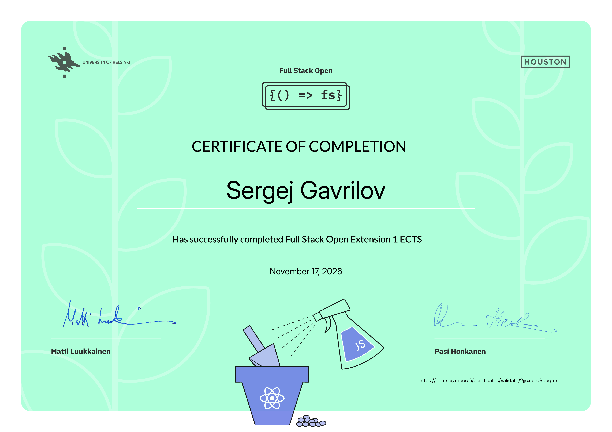

# Full Stack Open — Part 7

Solutions for [Full Stack Open, part 7](https://fullstackopen.com/en/part7).

Parts 0–5: [fullstack-open-part00-05](https://github.com/Kopfdreher/fullstack-open-part00-05). Part 6: [fullstack-open-part06](https://github.com/Kopfdreher/fullstack-open-part06).

Custom hooks, bundling with [esbuild](https://esbuild.github.io/) and [Vite](https://vite.dev/), class components, and an extended Blog app.

| Directory | What it covers |
| --- | --- |
| `routed-anecdotes` | Anecdotes with React Router and custom hooks |
| `bloglist` | Blog app with the part 7 features |
| `bloglist-tests` | Playwright tests for bloglist |

From each app directory: `npm install` and `npm run dev`. `routed-anecdotes` also needs `npm run server`. Bloglist tests need a client and server under `bloglist/` and `TEST_MONGODB_URI` (see `bloglist-tests/README.md`).

## Certificate

